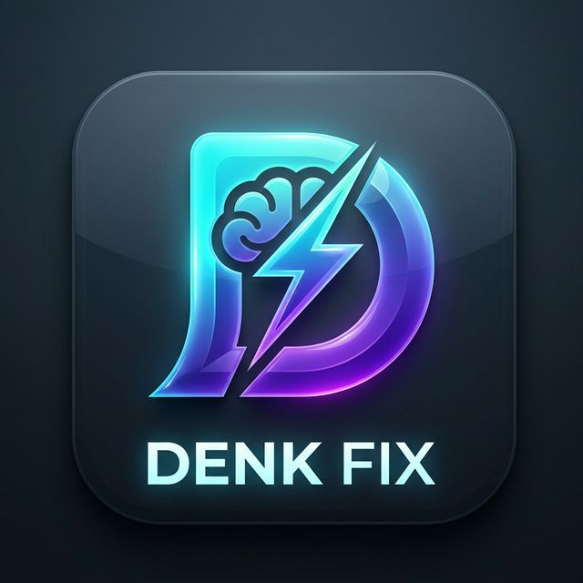
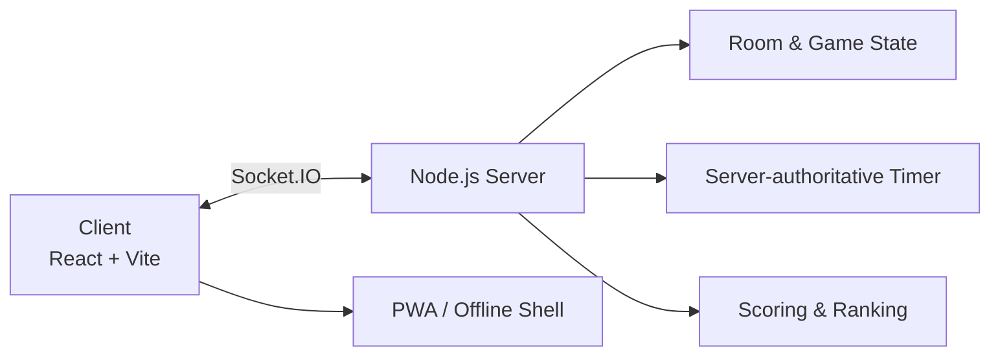

# Denk Fix - Online (Scattergories)



**Denk Fix** is a real-time multiplayer Scattergories game designed for learning German vocabulary.

## Projektüberblick (DE)

Denk Fix ist ein browserbasiertes Mehrspieler-Lernspiel für deutschen
Wortschatz. Spieler treten in Echtzeit in Räumen gegeneinander an, lösen
Kategorien wie „Möbel“, „Essen“ oder „Kleidung“ und bewerten ihre Antworten
gegenseitig. Der Server gibt die Zeit vor, sodass Antworten nach dem
Buzzern nicht mehr nachträglich geändert werden können.

**Technischer Fokus:** React-Frontend, Node.js/Socket.IO-Backend,
serverautoritative Spiellogik, Raumverwaltung, Live-Ranking und PWA-Support.

## Architektur



## Features
- 🚀 **Real-time Multiplayer:** Join rooms with friends using simple codes (e.g., DE-429).
- 🧠 **Vocabulary Learning:** Categories focused on useful everyday German words (Möbel, Essen, Kleidung, etc.).
- ⏱️ **Hard-Stop Timer:** Server-authoritative sync to prevent post-buzzer cheating.
- 🗳️ **Negative Veto System:** Fair and fun peer-review of answers.
- 👑 **Ranking System:** Automated scoring and live leaderboards.
- 📱 **PWA Ready:** Installable on iOS and Android for a native app experience.

## Project Structure
- `/frontend`: React + Vite + Vanilla CSS (Glassmorphism UI).
- `/backend`: Node.js + Socket.IO Server.

## Development Setup

Requirements: Node.js 20+ and npm.

### Backend
1. `cd backend`
2. `npm install`
3. `npm start`
*Server runs on port 3001*

### Frontend
1. `cd frontend`
2. `npm install`
3. `npm run dev`
*App runs at http://localhost:5173*

Production build:

```bash
cd frontend
npm run build
```

## Deployment
The frontend can be deployed to Vercel/Netlify and the backend to Render/Railway.
Set the backend URL in the frontend socket configuration before deploying.
See the Vite and Socket.IO documentation for environment-specific settings.

## Status

Playable locally and designed as a complete multiplayer game loop. A public
hosted demo is not currently linked; the repository contains the full client
and server implementation.

---
Created for German learners.
